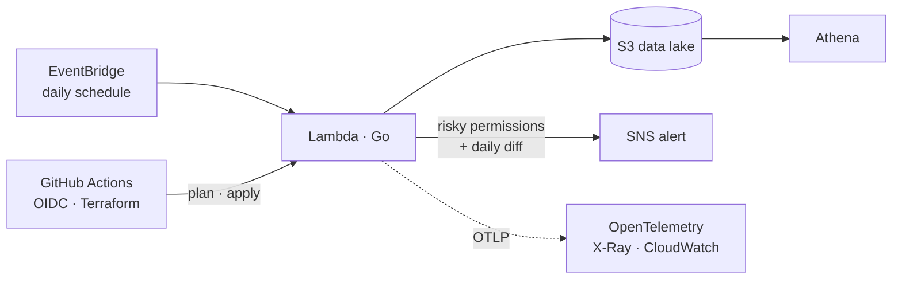

<h1 align="center">Pushpit Saluja</h1>

<p align="center">
  
</p>

<p align="center">
  <a href="https://linkedin.com/in/pushpit-saluja">LinkedIn</a> ·
  <a href="mailto:salujapushpit3@gmail.com">Email</a> ·
  <a href="https://cloudodyssey.substack.com">Blog</a>
</p>

```console
pushpit@prayagraj:~$ whoami
devops-engineer · AWS · Terraform · Go

pushpit@prayagraj:~$ cat focus.txt
infrastructure as code, CI/CD pipelines, observability, least-privilege security

pushpit@prayagraj:~$ cat philosophy.txt
if it isn't automated, it's a bug waiting to happen
if it isn't observable, it's already broken
```

## What I build



<sub>Architecture of <a href="https://github.com/saluja-ji/iam_inventory_pipeline">iam_inventory_pipeline</a>.</sub>

## Projects

| Project | What it does | Stack |
|---|---|---|
| [**iam_inventory_pipeline**](https://github.com/saluja-ji/iam_inventory_pipeline) | Daily AWS IAM snapshots, risk detection, and change alerts. Deployed through Terraform and GitHub Actions with OIDC (no static keys). | `Go` `Terraform` `Lambda` `Athena` `OpenTelemetry` |
| **OpenTelemetry Collector pipeline** | Traces, metrics, and logs from a Go service over OTLP into a Collector. | `Go` `OpenTelemetry` `Docker` |
| [**wikigo**](https://github.com/saluja-ji/wikigo) | Published Go SDK for the Wikimedia API with rate limiting, backoff, and retries. [pkg.go.dev](https://pkg.go.dev/github.com/saluja-ji/wikigo) | `Go` `net/http` |

## Toolbox


## Writing

I write about cloud and systems internals at **[Cloud Odyssey](https://cloudodyssey.substack.com)**.

